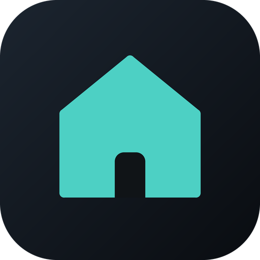
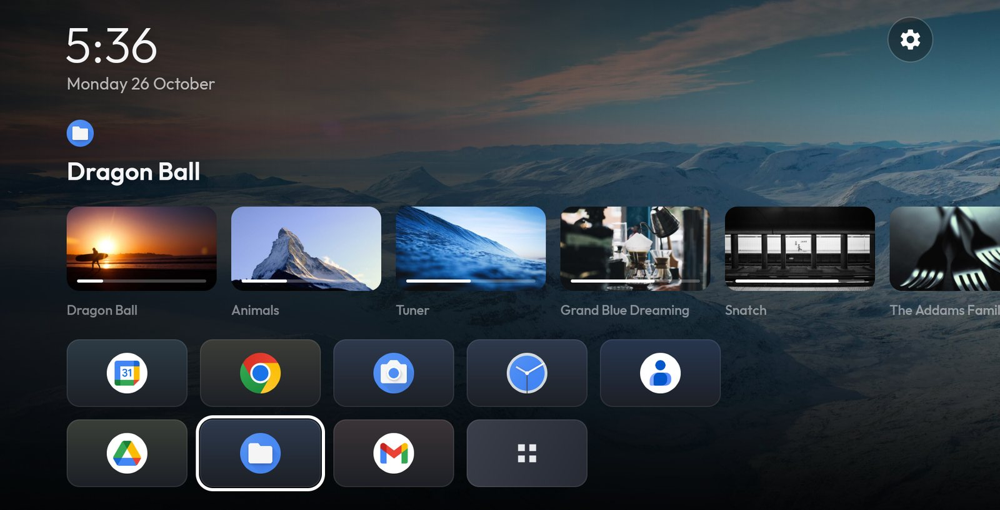
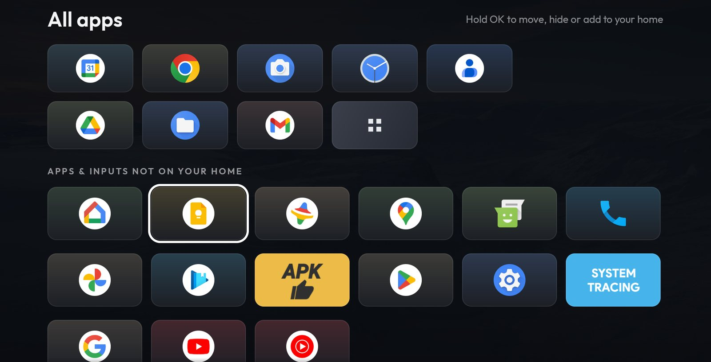
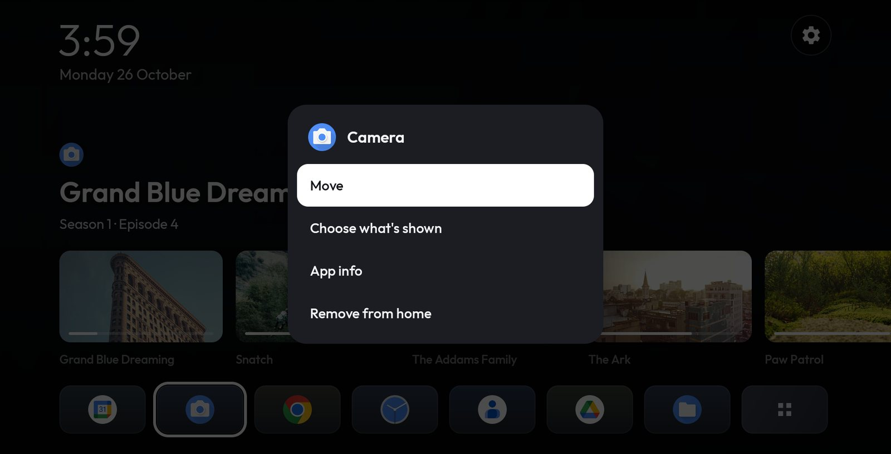
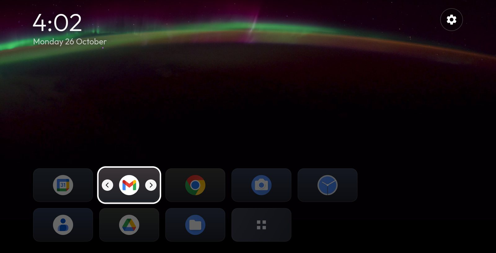
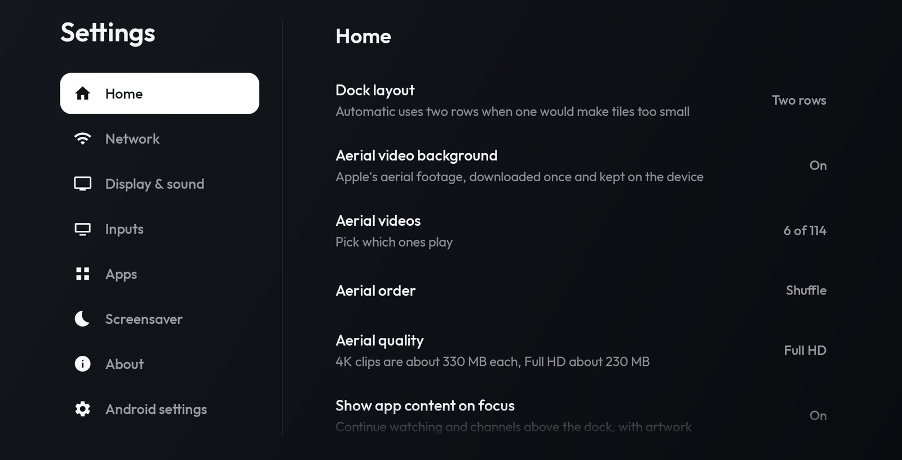

<p align="center"></p>

# Simple Home TV

Just another home screen for Android TV. I wrote it after debloating my Sony Bravia: the stock launcher was busy,
slow and full of things I never asked for, and this TV runs a firmware without Google Play, so half of what it
pushed did not even work. Simple Home is the opposite: your apps and inputs, a calm aerial video behind them, and
nothing else unless you ask for it.

The repo is also where I keep the bits that make a TV without Google Play usable day to day: which store to use
and how to keep Plex running.



## What it does

- **Home.** Pinned apps and HDMI inputs in a dock of one or two rows, icons only, over Apple's aerial videos (Full HD
  or 4K, and you pick which ones play). The clock and date sit in the corner, the gear opens Settings.
- **What's on.** Focus an app and the row above shows what it publishes: Continue watching, channels. Plex fills it
  nicely. Focus an HDMI input and you get its live picture in a box, with the aerial paused and blurred around it.
- **All apps.** Press Down from the dock. Everything that isn't pinned, in an order you can change. Hold OK on a tile
  to add it to the home, move it, hide it or uninstall it. Hidden apps come back from Settings.
- **Moving tiles.** Hold OK and pick Move: the tile follows left and right (and up and down on two rows) until you
  press OK.
- **Screensaver.** Apple's aerial videos, with the time in a corner.
- **Settings.** Network, display and sound, inputs, apps and app stores, the screensaver, and a shortcut to the
  TV's own Android settings.

| | |
|---|---|
|  |  |
|  |  |

## Install

Grab the APK from [Releases](https://github.com/xiaodoudou/simple-home-tv/releases), then with
[adb](https://developer.android.com/tools/adb) connected to the TV:

```sh
adb install simple-home-tv-0.4.3.apk
adb shell cmd package set-home-activity com.simplehometv/.HomeActivity
```

Press Home on the remote and you are there. If the TV asks which home app to use, pick Simple Home.

Some firmwares (Xiaomi's Chinese one) only let their own home be the home. There, turn on "Simple Home: Home
button" in the TV's Accessibility settings and the Home button opens Simple Home anyway.

It needs Android TV 7 or later. The rows of what's on need Android 8, since that's when apps got a way to publish
them.

## TVs without Google Play

Plenty of TVs ship without Google Play or Google services: China-market Sony Bravia models (mine is one), Xiaomi TVs
running their Chinese firmware, and others. Android TV apps mostly still run on them, but a few things need help.
Simple Home tries to make that part painless.

### Plex

Recent Plex builds (the 2026 rewrite) crash a few seconds after launch on these TVs. The new code starts a casting
library that only works with Google Play services, even though the app itself checks for them and skips it. Stores
keep offering that update, and once it's installed Plex won't open.

[plex-android-tv-no-play-services](https://github.com/xiaodoudou/plex-android-tv-no-play-services) fixes it: a script
that patches the official Plex APK so the casting library steps aside when Google Play services are missing (on a TV
that has them, Plex runs untouched), then re-signs it with your own key. On my TV it signs in and plays like it
should. The catch is that a re-signed Plex can't update from a store anymore; each new version goes through the
script again, with the same key so you stay signed in.

### Getting apps

No store on the TV yet? Settings > Apps can install Aurora, APKUpdater, SmartTube and Moonlight for you. It downloads
them from F-Droid or from the project's latest GitHub release, in the build for the TV's processor. The first time,
Android asks you to let Simple Home install apps, then it asks you to confirm each one.

Once a store is in, the same page sets which one "Get" opens:

- [Aurora Store](https://f-droid.org/packages/com.aurora.store) opens an app's Google Play page directly, without a
  Google account.
- [APKUpdater](https://github.com/rumboalla/apkupdater) keeps installed apps updated and has a layout that works with
  a remote.

Having both works well: Aurora to get apps, APKUpdater to keep them current. If Plex is patched, tell both to ignore
its updates.

### YouTube

[SmartTube](https://smarttubeapp.github.io) works without Google services, has no ads, and signs in with a code like
the official app.

### Debloating

China-market TVs carry a second layer of apps on top of Android TV: their own home, stores, ads and analytics.
[scripts/debloat](scripts/debloat) holds what I turn off on my Sony and Xiaomi TVs, one list per brand split into
groups, plus two scripts that apply a list over adb. Nothing gets uninstalled. Apps are only disabled, and `--undo`
turns them back on.

Connect to the TV first (`adb connect 192.168.1.20:5555`, then accept the prompt on the TV) and run the script from a
clone of this repo.

Linux, macOS or Git Bash:

```sh
scripts/debloat.sh xiaomi                  # disable everything in scripts/debloat/xiaomi.txt
scripts/debloat.sh xiaomi --skip voice     # keep a group (several: --skip voice,screensavers)
scripts/debloat.sh xiaomi --undo           # turn them all back on
```

Windows PowerShell:

```powershell
.\scripts\debloat.ps1 xiaomi
.\scripts\debloat.ps1 xiaomi -Skip voice
.\scripts\debloat.ps1 xiaomi -Undo
```

With several TVs connected, add `--serial 192.168.1.20:5555` (`-Serial` in PowerShell). The
[Debloat your TV](https://xiaodoudou.github.io/simple-home-tv/debloat) page says what each group holds and what to
leave alone.

### What still needs Google

The official YouTube app, Google sign-in inside apps and Play-billed purchases need Google services, so they won't
work on these TVs whatever the store.

## Building

You need JDK 17 and the Android SDK (Android Studio brings both).

```sh
./gradlew assembleDebug        # app/build/outputs/apk/debug/app-debug.apk
./gradlew testDebugUnitTest lintDebug
```

[CONTRIBUTING.md](CONTRIBUTING.md) has the rest: running it on an emulator, demo content, commits and releases.

## Privacy

No ads, no analytics, no account and no server of its own. What it talks to, and why, is in the
[privacy policy](https://xiaodoudou.github.io/simple-home-tv/privacy).

## Credits

- Aerial videos by Apple, streamed from Apple's servers; they are not part of this repo.
- [Outfit](https://fonts.google.com/specimen/Outfit) font, SIL Open Font License 1.1.

## License

[MIT](LICENSE)
